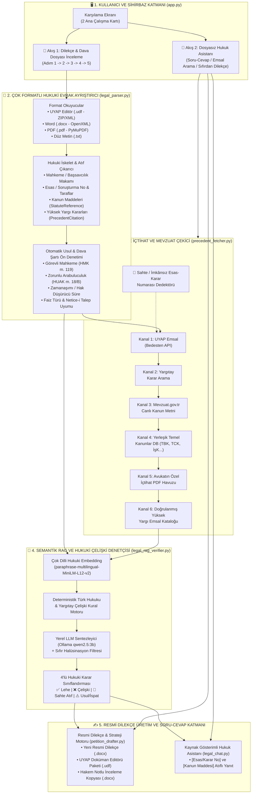
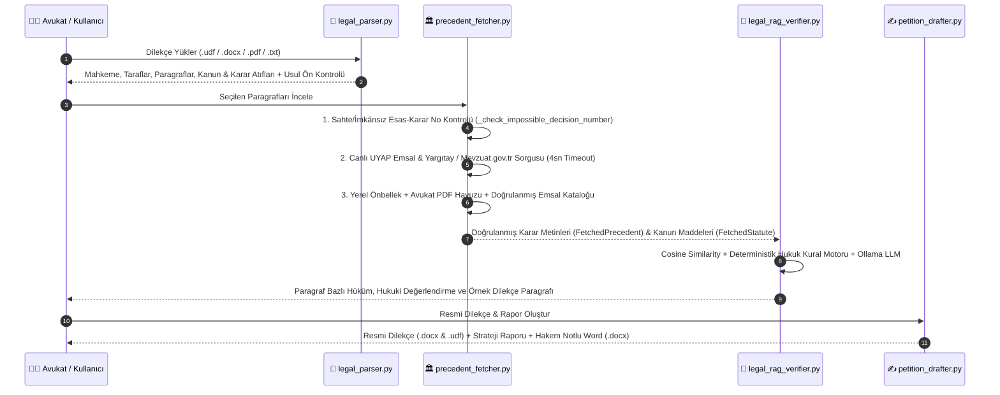

# ⚖️ Avukat Asistanı — Yapay Zekâ Destekli Hukuki Dilekçe, İçtihat Doğrulama ve Strateji Platformu

[](https://www.python.org/)
[](https://streamlit.io/)
[](https://uyap.gov.tr/)
[](https://python-docx.readthedocs.io/)
[](https://huggingface.co/sentence-transformers/paraphrase-multilingual-MiniLM-L12-v2)

**Avukat Asistanı**, Türk hukuk pratiğinde avukatların **UYAP Doküman Editörü (`.udf`)**, **Word (`.docx`)**, **PDF (`.pdf`)** veya **Metin (`.txt`)** formatındaki dava dilekçelerini, cevap dilekçelerini, iddianameleri ve savcılık şikâyet evraklarını paragraf paragraf inceleyen; dilekçe içindeki **hatalı veya uydurma (yapay zekâ halüsinasyonu) Yargıtay karar atıflarını** yakalayan; **usul, dava şartı, zamanaşımı ve zorunlu arabuluculuk** kontrollerini otomatik yapan ve doğrulanmış yüksek yargı kararlarıyla **mahkemeye/UYAP'a sunulmaya hazır resmi dilekçe (`.docx` & `.udf`)** üreten uçtan uca bir hukuk teknolojisi platformudur.

---

## 🎯 Temel Yetenekler ve Çözülen Problemler

| Problem Alanı | Avukat Asistanı Çözümü |
| :--- | :--- |
| **🚨 Sahte / Uydurma İçtihat Atıfları (Halüsinasyon)** | Genel amaçlı sohbet botlarının (ChatGPT vb.) uydurduğu gerçekte var olmayan Esas/Karar numaralarını (`2024/999888 E.` vb.), görev dışı daire/suç eşleşmelerini ve kanuna açıkça aykırı içtihat iddialarını otomatik tespit eder. |
| **🏛️ 6 Kanallı Yüksek Yargı ve Mevzuat Doğrulaması** | Canlı UYAP Emsal (Bedesten) API, Yargıtay Karar Arama, Mevzuat.gov.tr, Yerleşik Temel Kanunlar Veritabanı, Avukatın Özel Karar PDF'leri ve Doğrulanmış Yüksek Yargı Kataloğu üzerinden kesintisiz (`%100` çalışma garantili) içtihat doğrulaması yapar. |
| **🛡️ Çift Yönlü Avukat Çalışma Modu** | **1. Karşı Tarafın Dilekçesi / İddianame:** Karşı tarafın iddialarını ve sahte karar atıflarını çürüten *Cevap / Savunma / İtiraz Dilekçesi* hazırlar.<br>**2. Kendi Taslak Dilekçem:** Avukatın kendi dilekçesindeki usul eksiklerini giderir ve lehe Yargıtay kararlarıyla güçlendirir. |
| **📄 UYAP (`.udf`) ve Word (`.docx`) Tam Uyum** | Doğrudan UYAP Doküman Editörü'nden alınan `.udf` dosyalarını (`content.xml` CDATA + `startOffset`/`length` paragraf haritası) okur ve üretilen yeni resmi dilekçeyi hem **`.udf`** hem **`.docx`** olarak indirir. |
| **🔒 Orijinal Dilekçe Metnini Bozmayan Hakem Notları** | Avukatın yüklediği orijinal `.docx` dilekçenin tek bir kelimesine bile dokunmadan, yalnızca incelenen paragrafların hemen altına XML düzeyinde (`addnext`) renkli **`🔎 [HUKUKİ HAKEM VE İÇTİHAT NOTU]`** kutuları ekler. |

---

## 🏗️ Sistem Mimarisi

Aşağıdaki şema, yüklenen bir hukuki evrakın ayrıştırılmasından 6 kanallı içtihat doğrulamasına, semantik RAG analizinden `.udf` / `.docx` resmi dilekçe üretimine kadar tüm modüller arası veri akışını göstermektedir:



---

## 🔄 6 Kanallı Şelale (Waterfall) İçtihat ve Mevzuat Doğrulama Akışı

Sistem, resmi kurum sunucularında bağlantı kısıtlaması veya bakım olsa dahi asla yarıda kalmaz; 6 katmanlı şelale mimarisiyle her koşulda doğrulanmış karar ve kanun metnine ulaşır:



---

## 📦 Modül Mimarisi ve Görev Dağılımı

| Modül Dosyası | Katman | Temel Sorumlulukları |
| :--- | :--- | :--- |
| **`app.py`** | Web Arayüzü (Streamlit) | 2 kartlı yalın karşılama ekranı, 5 adımlı dosya inceleme sihirbazı, dosyasız sohbet/emsal arama/dilekçe yazım araçları, kurumsal gece mavisi (Dark) tema ve oturum yönetimi. |
| **`legal_parser.py`** | Evrak & Atıf Ayrıştırıcı | `.udf`, `.docx`, `.pdf` ve `.txt` dosyalarını okuma; mahkeme, dosya no, taraflar, kanun maddeleri (`StatuteReference`), yüksek yargı kararları (`PrecedentCitation`) ve 5'li usul/dava şartı kontrolü (`ProceduralCheckItem`). |
| **`precedent_fetcher.py`** | 6 Kanallı İçtihat & Kanun Çekici | UYAP Bedesten API, Yargıtay, Mevzuat.gov.tr, `CORE_STATUTES_DB`, kullanıcı PDF havuzu ve `VERIFIED_PRECEDENTS_CATALOG` üzerinden içtihat çekimi + uydurma Esas/Karar numarası tespiti. |
| **`legal_rag_verifier.py`** | Semantik RAG & Çelişki Motoru | `paraphrase-multilingual-MiniLM-L12-v2` vektör benzerliği, Türk hukuku deterministik çelişki kuralları, Ollama (`qwen2.5:3b`) yorum sentezi ve yönetici strateji özeti (`ExecutiveLegalSummary`). |
| **`petition_drafter.py`** | Resmi Dilekçe & `.udf`/`.docx` Üretici | İncelenen dosyaya karşı *Cevap/Savunma Dilekçesi* veya *Güçlendirilmiş Dava Dilekçesi* yazımı; sıfırdan dilekçe üretimi; `.docx`, UYAP `.udf` ve orijinal metni bozmayan hakem notlu `.docx` çıktısı. |
| **`legal_chat.py`** | Kaynak Gösterimli Hukuk Asistanı | Dosya bağlamına, kanun maddelerine ve Yargıtay kararlarına dayalı, `[Esas/Karar No]`, `[Kanun Maddesi]` ve `[Paragraf No]` etiketli hukuki soru-cevap motoru. |

---

## ⚖️ Desteklenen Hukuk Dalları ve Otomatik Usul Kontrolleri

| Hukuk Dalı | Kapsanan Temel Mevzuat | Otomatik Denetlenen Usul Şartları ve Kritik İçtihat Noktaları |
| :--- | :--- | :--- |
| **İş Hukuku** | 4857 S. İşK, 7036 S. İşMK, TBK | Zorunlu arabuluculuk (7036 S.K. m. 3), istifa halinde kıdem/ihbar tazminatı, İşK m. 25/II haklı fesihte savunma şartı (Yargıtay İBK 2017/9 E., 2018/10 K.), fazla mesaide `%50` zam, ara dinlenmesi ve hakkaniyet indirimi, kıdem tazminatında en yüksek banka mevduat faizi. |
| **Borçlar ve Kira Hukuku** | 6098 S. TBK, 6325 S. HUAK | Kira davalarında zorunlu arabuluculuk dava şartı (HUAK m. 18/B), 5 yılı dolmayan kira sözleşmelerinde TÜFE üst sınırı (TBK m. 344/1-2), 5 yılı aşan sözleşmelerde emsal rayiç ve eski kiracı hakkaniyet indirimi (TBK m. 344/3), ihtiyaç nedeniyle tahliyede 1 aylık dava açma süresi (TBK m. 350). |
| **Ceza Hukuku** | 5237 S. TCK, 5271 S. CMK | Ticari sözleşmeden / karşılıksız çekten doğan hukuki ihtilaf ile dolandırıcılık (TCK m. 157-158) ayrımı, önceden doğmuş borçta hile unsuru (Yargıtay CGK & 15. CD), güveni kötüye kullanmada zilyetlik devri (TCK m. 155), CMK m. 128 el koyma şartları. |
| **İcra ve İflas Hukuku** | 2004 S. İİK | İtirazın iptali davasında 1 yıllık hak düşürücü süre ve `%20`'den aşağı olmamak üzere icra inkâr tazminatı (İİK m. 67), menfi tespit davasında ihtiyati tedbir ve teminat şartları (İİK m. 72). |
| **Aile Hukuku** | 4721 S. TMK | Boşanmada kusur karşılaştırması (TMK m. 166), maddi/manevi tazminat şartları (TMK m. 174), yoksulluk ve iştirak nafakası kriterleri (TMK m. 175). |
| **Ticaret Hukuku** | 6102 S. TTK | Ticari davalarda zorunlu arabuluculuk (TTK m. 5/A), fatura içeriğine 8 gün içinde itiraz ve sözleş적 temel ilişkisi (TTK m. 21/2), ticari avans faizi. |
| **İdare ve Vergi Hukuku** | 2577 S. İYUK, 213 S. VUK | İptal ve tam yargı davalarında 60/30 günlük dava açma süresi (İYUK m. 7), yürütmenin durdurulmasında telafisi güç zarar ve açık hukuka aykırılık şartlarının birlikte gerçekleşmesi (İYUK m. 27/2). |
| **Tüketici Hukuku** | 6502 S. TKHK | Tüketici mahkemelerinde zorunlu arabuluculuk (TKHK m. 73/A), ayıplı mal ve hizmette seçimlik haklar (TKHK m. 11, 15). |

---

## 🔍 4'lü Hukuki Denetim Karar Sınıflandırması

İncelenen her bir dilekçe paragrafı aşağıdaki 4 hukuki denetim sınıfından birine atanır:

| Rozet | Karar Kodu | Hukuki Anlamı ve Sistemin Ürettiği Aksiyon |
| :--- | :--- | :--- |
| **✅ Emsal Kararla Destekleniyor** | `EMSAL_VE_KANUNLA_DESTEKLENIYOR` | İddia yürürlükteki kanun maddeleri ve yerleşik yüksek yargı içtihatlarıyla tam uyumludur. Doğrulanmış Esas/Karar künyesi ve alıntı paragrafı sunulur. |
| **❌ Yerleşik İçtihatla Çelişiyor** | `ICTIHAT_VE_KANUNLA_CELISIYOR` | İleri sürülen talep emredici kanun hükümlerine veya yerleşik Yargıtay/İBK/HGK/CGK içtihatlarına aykırıdır. Karşı tarafın dilekçesiyse çürütme paragrafı, kendi dilekçemizse revize paragraf üretilir. |
| **🚨 Sahte / Uydurma İçtihat Atfı** | `SAHTE_VEYA_CARPITILMIS_ATIF` | Paragrafta atıf yapılan Esas/Karar numarası resmi kayıtlarda mevcut değildir (yapay zekâ halüsinasyonu) veya karar içeriği tamamen çarpıtılmıştır. HMK m. 29 kapsamında ifşa metni ve gerçek emsal karar sunulur. |
| **⚠️ Ek İspat / Usul Şartı Uyarısı** | `EK_ISPAT_VE_USUL_UYARISI` | Talebin kabulü için zorunlu arabuluculuk son tutanağı, yazılı delille somutlaştırma (HMK m. 194) veya süre şartı gerekmektedir. Eksik usul adımı ve delil listesi uyarısı verilir. |

---

## 📁 Desteklenen Girdi ve Çıktı Dosya Formatları

| Format | Uzantı | Okuma (Girdi) | Üretim (Çıktı) | Açıklama |
| :--- | :---: | :---: | :---: | :--- |
| **UYAP Doküman Editörü** | `.udf` | ✅ | ✅ | `<template format_id="1.8">` standardında `content.xml` (CDATA + `startOffset`/`length` paragraf haritası) ZIP paketi. |
| **Microsoft Word** | `.docx` | ✅ | ✅ | Resmi mahkeme formatında yeni dilekçe + orijinal metni bozmayan hakem notlu inceleme kopyası. |
| **Adobe PDF** | `.pdf` | ✅ | — | PyMuPDF ile UYAP e-imza altbilgisi ve sayfa numarası gürültüsü temizlenmiş tam metin okuma. |
| **Düz Metin** | `.txt` | ✅ | ✅ | UTF-8 tam metin dilekçe okuma ve indirme. |
| **İnceleme Tablosu (Excel)** | `.csv` | — | ✅ | UTF-8 BOM (`utf-8-sig`) kodlamalı, Türkçe karakter uyumlu Excel denetim raporu. |
| **Çalışma Kaydı** | `.analiz.json` | ✅ | ✅ | İncelenen dosyanın tüm analiz sonuçlarını kaydedip kaldığınız yerden devam etme formatı. |

---

## 🚀 Kurulum ve Çalıştırma

### 1. Tek Tıkla Otomatik Kurulum ve Başlatma (Windows)

Proje klasöründeki **`baslat.bat`** dosyasına çift tıklamanız yeterlidir. Sanal ortam mevcut değilse otomatik olarak **`kurulum_yap.bat`** devreye girer ve tüm bağımlılıkları kurar:

```bat
:: 1. İlk kurulum (gerekirse otomatik çalışır)
kurulum_yap.bat

:: 2. Uygulamayı başlatma
baslat.bat
```

### 2. Manuel Terminal Kurulumu

```bash
python -m venv .venv
.venv\Scripts\activate
pip install -r requirements.txt
streamlit run app.py
```

> **İsteğe Bağlı Yerel LLM Desteği (Ollama):** Sistem, internet veya yerel LLM olmasa dahi deterministik Türk hukuku kural motoru ve çok dilli vektör modeli (`paraphrase-multilingual-MiniLM-L12-v2`) ile `%100` çalışır. Ek olarak yerel LLM sentezi için [Ollama](https://ollama.com/) üzerinde `ollama pull qwen2.5:3b` komutunu çalıştırabilirsiniz.

---

## 🧪 Hazır Örnek Test Dilekçeleri (`ornek_dilekceler/`)

Sistemi hemen test edebilmeniz için `ornek_dilekceler/` klasöründe hem **UYAP (`.udf`)** hem **Word (`.docx`)** formatında 6 adet gerçekçi test dilekçesi yer almaktadır:

| Dosya Adı (`.udf` & `.docx`) | Hukuk Dalı | Önerilen Kart | Test Edilen Senaryo |
| :--- | :--- | :--- | :--- |
| **`1_Is_Hukuku_Karsi_Taraf_Dava_Dilekcesi`** | İş Hukuku | 🛡️ Karşı Tarafın Dilekçesi | Uydurma Yargıtay kararı (`2024/999888 E.`), sebepsiz istifada kıdem/ihbar talebi, İşK m. 25/II savunma iddiası ve `%100` zamlı / bileşik faizli fazla mesai talebinin çürütülüp **Cevap Dilekçesi** yazılması. |
| **`2_Kira_Tespit_ve_Tahliye_Taslak_Dilekce`** | Borçlar & Kira | ✍️ Kendi Taslak Dilekçem | Zorunlu arabuluculuk dava şartı (`HUAK m. 18/B`) uyarısı, `TBK m. 344/3` emsal rayiç + eski kiracı hakkaniyet indirimi ve `TBK m. 350/1` konut ihtiyacı iddialarının Yargıtay HGK/3. HD kararlarıyla güçlendirilmesi. |
| **`3_Ceza_Savcilik_Sikayet_Dolandiricilik`** | Ceza Hukuku | 🛡️ Karşı Tarafın Dilekçesi | Ticari sözleşme ve karşılıksız çek borcunu `TCK m. 158/1-h` nitelikli dolandırıcılık gibi gösteren şikâyetteki sahte kararın (`2023/888999 E.`) yakalanması ve Başsavcılığa **KYOK (Takipsizlik) Savunma Dilekçesi** üretilmesi. |

---

## 📂 Proje Dizin Yapısı

```text
hukuk_asistani/
├── app.py                      # Streamlit Web Arayüzü ve 5 Adımlı Sihirbaz
├── legal_parser.py             # .udf, .docx, .pdf, .txt Hukuki Evrak ve Atıf Ayrıştırıcı
├── precedent_fetcher.py        # 6 Kanallı İçtihat/Mevzuat Çekici ve Sahte Karar Dedektörü
├── legal_rag_verifier.py       # Semantik RAG, Deterministik Kural Motoru ve Ollama Denetçisi
├── petition_drafter.py         # Resmi Dilekçe (.docx & .udf) ve Hakem Notlu Belge Üretici
├── legal_chat.py               # Kaynak Gösterimli Hukuki Soru-Cevap Asistanı
├── requirements.txt            # Python Kütüphane Bağımlılıkları
├── baslat.bat                  # Tek Tıkla Başlatıcı (Windows)
├── kurulum_yap.bat             # Otomatik Sanal Ortam ve Paket Kurucu (Windows)
├── yol_haritasi.txt            # Mimari Tasarım ve Geliştirme Kayıt Defteri
├── .streamlit/
│   └── config.toml             # Kurumsal Gece Mavisi (Dark) Tema Yapılandırması
├── ornek_dilekceler/           # Test İçin 6 Adet Hazır .udf ve .docx Dilekçe
└── raporlar/
    └── oturumlar/              # Kaydedilen İnceleme Oturumları (.analiz.json)
```
